<div align="center">

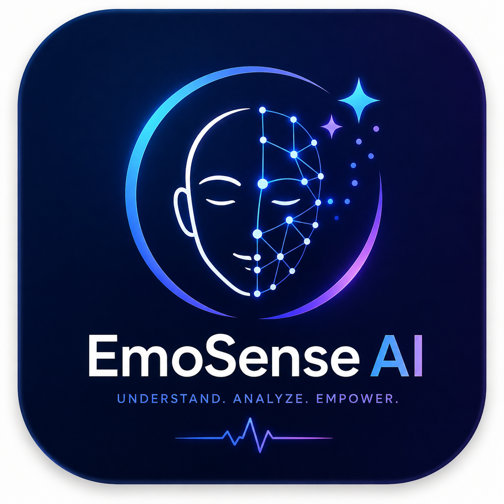

# EmoSense AI

**AI-Based Facial Emotion Recognition System**

On-device facial expression recognition for Android, built with Flutter, Google ML Kit and a ResNet-18 CNN.
Photos never leave the phone.


Final Year Project · Department of Information Technology · The Islamia University of Bahawalpur

</div>

---

## Contents

- [About](#about)
- [Features](#features)
- [Screenshots](#screenshots)
- [How it works](#how-it-works)
- [Architecture](#architecture)
- [Tech stack](#tech-stack)
- [AI model](#ai-model)
- [Project structure](#project-structure)
- [Getting started](#getting-started)
- [Privacy and security](#privacy-and-security)
- [Documentation](#documentation)
- [Future work](#future-work)
- [Author](#author)

## About

EmoSense AI recognises a person's facial expression from a photo and reports one of seven emotions: **angry, disgust, fear, happy, neutral, sad and surprise**.

The user takes a selfie or uploads a photo. Google ML Kit finds the face, the app crops and normalises it, and a ResNet-18 convolutional neural network trained on **FER-2013** classifies it. The network runs **on the device** with ONNX Runtime, so analysis is fast, private and works offline.

Results are saved to a private history synced with Cloud Firestore, summarised on an Insights screen, and can be discussed with a supportive AI assistant powered by Google Gemini, which receives text only, never photos.

> EmoSense AI estimates facial expressions. It does not measure a person's real feelings and is not a medical or psychological tool.

## Features

| | Feature | Description |
| --- | --- | --- |
| 📷 | **Photo emotion scan** | Take a selfie or upload a photo; the face is detected and cropped automatically |
| 🧠 | **On-device AI** | ResNet-18 CNN through ONNX Runtime; no image is uploaded |
| 📊 | **Detailed results** | Emotion, confidence %, low-confidence warning and scores for all 7 classes |
| 🗂️ | **History** | Every result saved on the device and synced to the cloud, with offline support |
| 🔍 | **Analysis details** | All class scores, date and capture source for each saved result |
| 📈 | **Insights** | Emotion distribution, 7-day activity, average confidence, camera vs gallery |
| 💬 | **AI support chat** | Gemini-powered assistant, per result or general; offline fallback and Retry |
| 🔐 | **Accounts** | Email/password and Google sign-in, password reset, profile editing, account deletion |

## Screenshots

<div align="center">

| Home | History | Analysis detail | Insights | Profile |
| :---: | :---: | :---: | :---: | :---: |
| 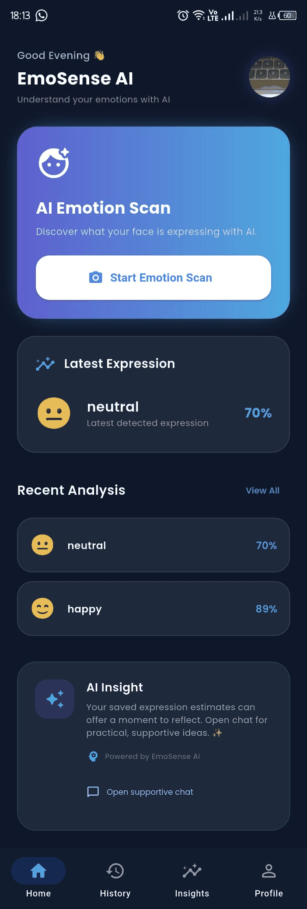 | 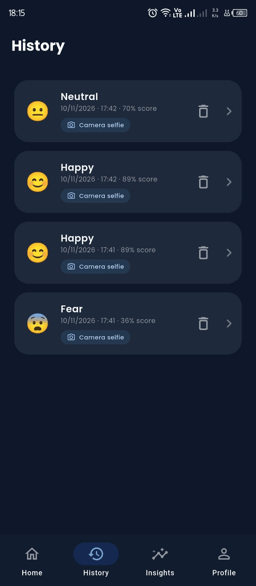 | 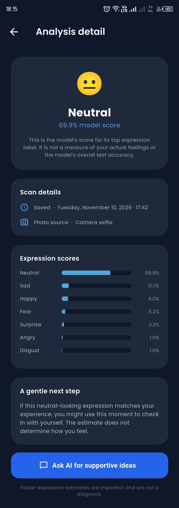 | 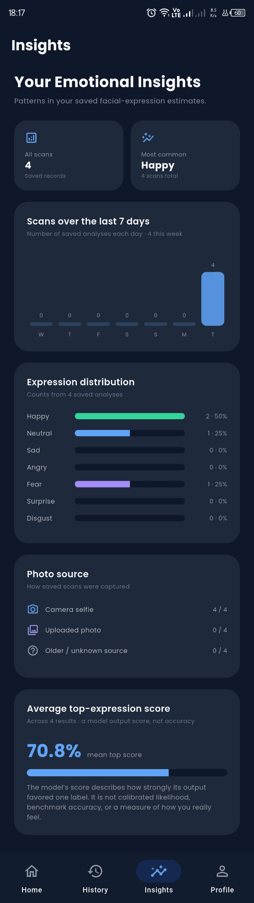 | 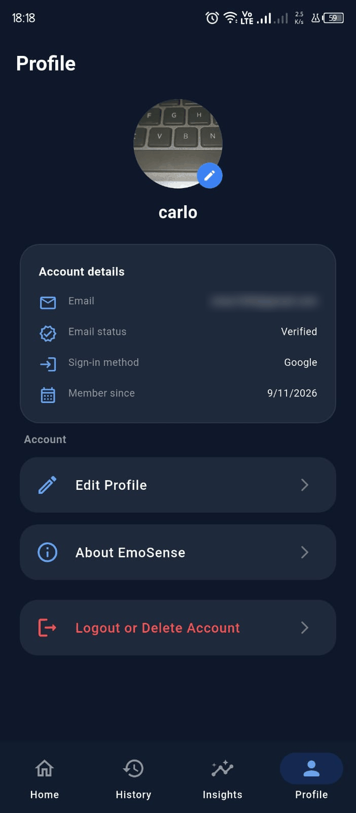 |

</div>

## How it works

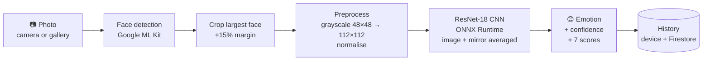

1. **Capture**: a camera photo or gallery image (up to 1024 × 1024).
2. **Detect**: ML Kit finds faces; the largest one is used.
3. **Crop**: a square 15% larger than the face, after correcting the photo's rotation.
4. **Preprocess**: grayscale, 48 × 48 (FER-2013 format), 112 × 112, ImageNet normalisation.
5. **Classify**: the model runs on the image and its mirror image; the softmax probabilities are averaged.
6. **Show and save**: the top class and its confidence are displayed and saved to history.

## Architecture

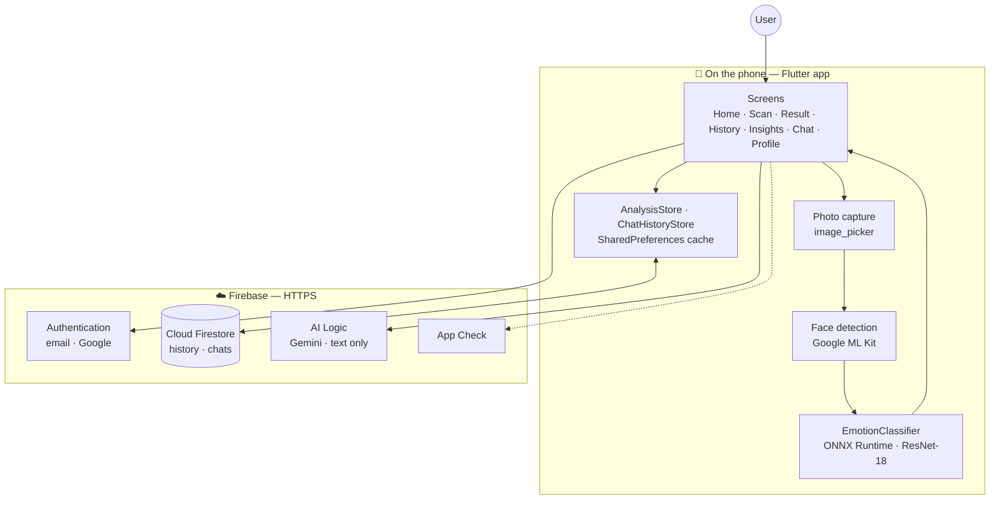

<details>
<summary><b>More design diagrams</b> (click to expand)</summary>

<br/>

**System architecture**

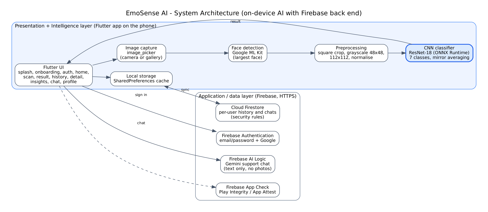

**Activity diagram: capture and analyze emotion**

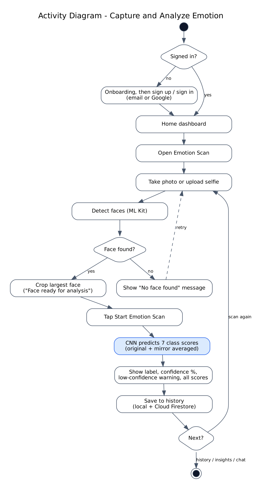

**Sequence diagram: photo emotion scan**

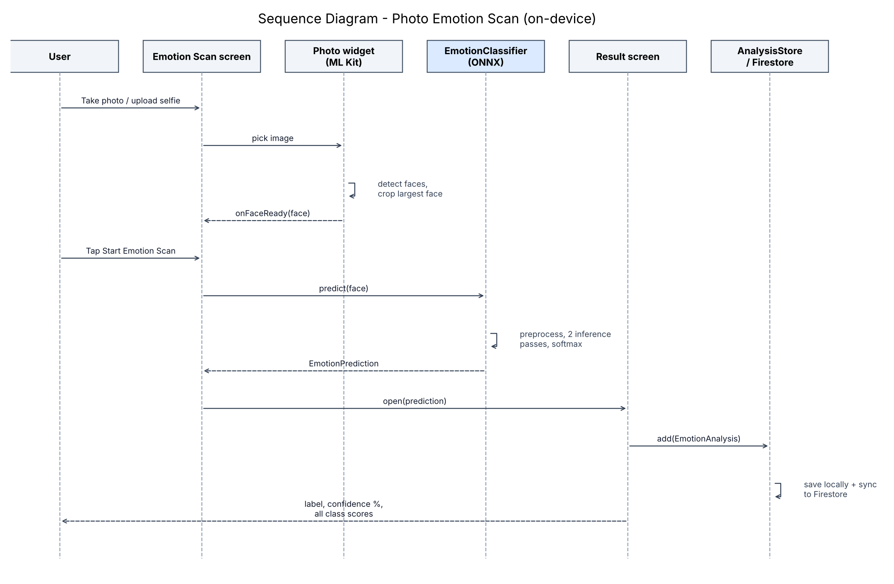

**Class diagram**

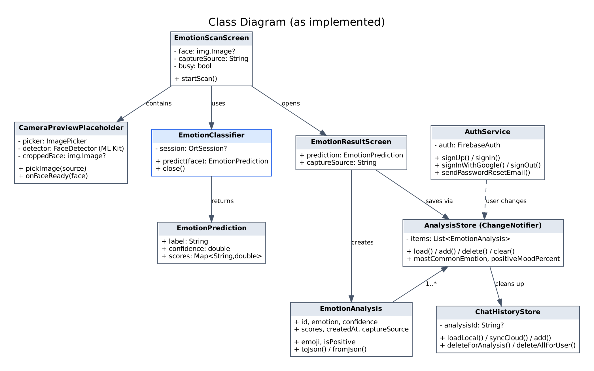

**Component diagram**

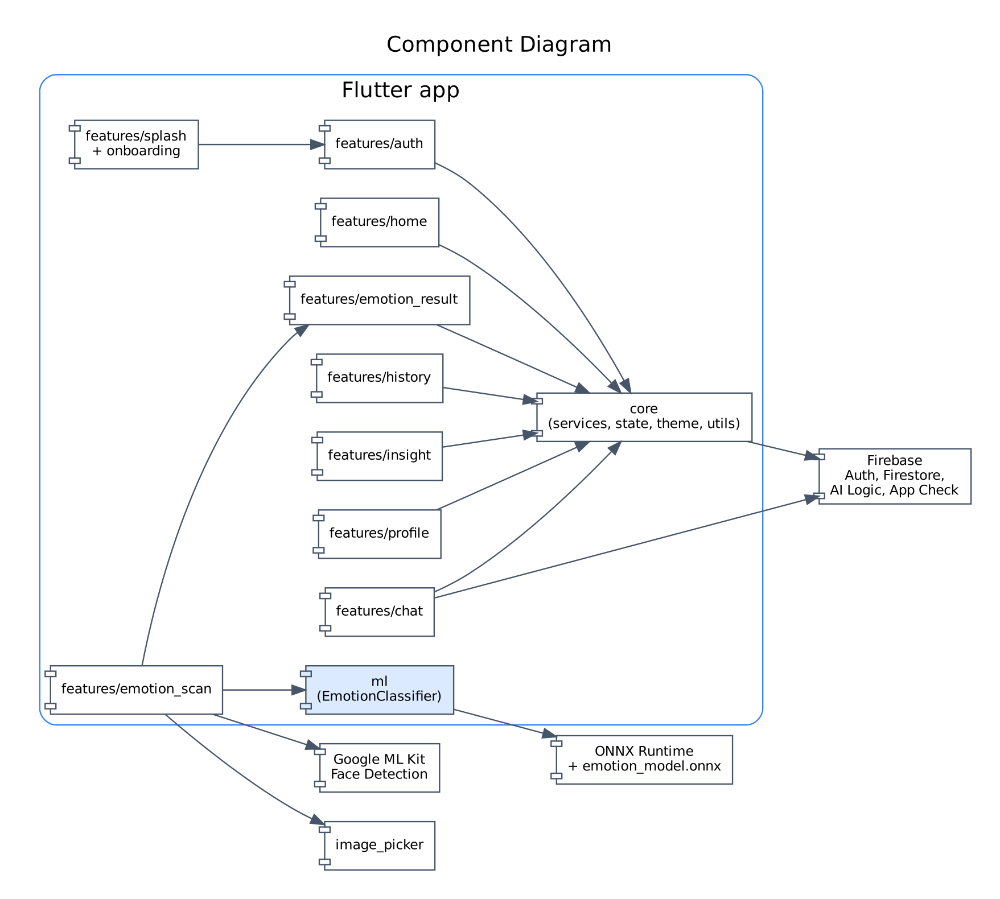

**Data model (Cloud Firestore)**

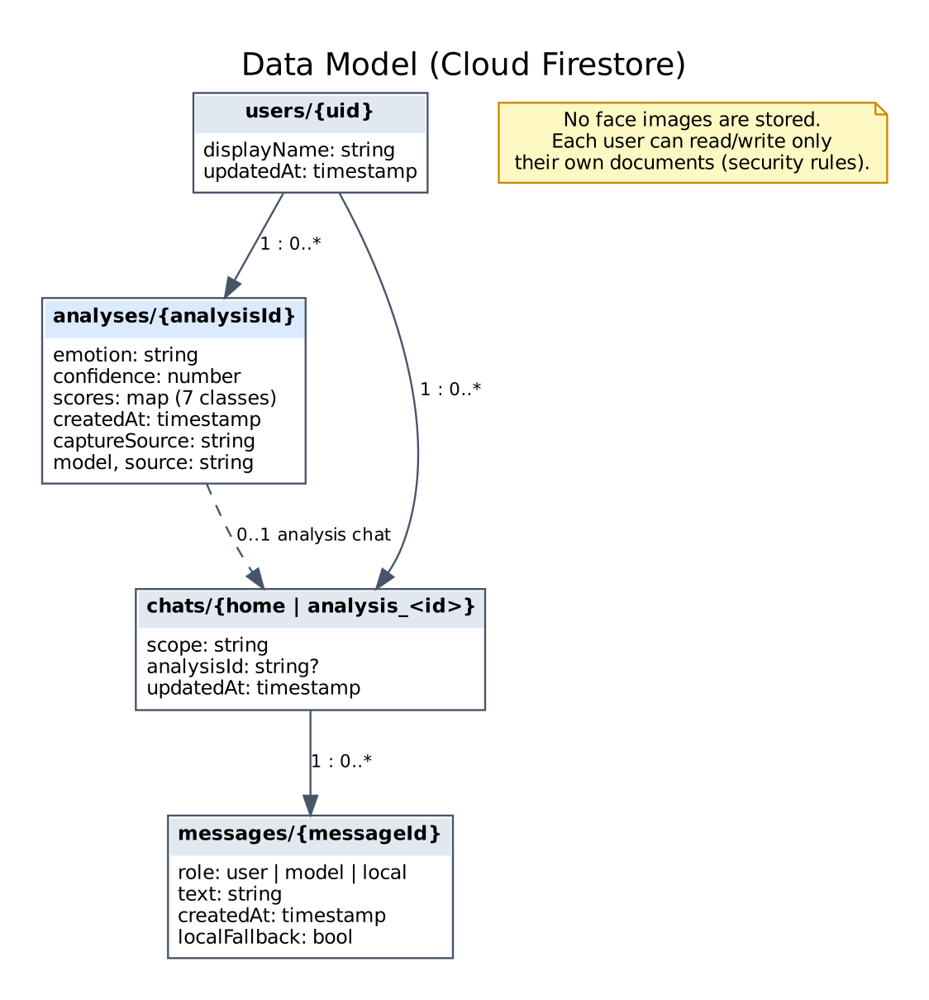

</details>

## Tech stack

| Layer | Technology |
| --- | --- |
| Mobile app | Flutter 3.44+, Dart 3.12 |
| Face detection | `google_mlkit_face_detection` |
| Emotion model | ResNet-18 (PyTorch) → ONNX, run with `flutter_onnxruntime` |
| Image handling | `image`, `image_picker` |
| Authentication | Firebase Authentication, `google_sign_in` |
| Database | Cloud Firestore (offline cache) + `shared_preferences` |
| AI assistant | Firebase AI Logic, Gemini `gemini-3.1-flash-lite` |
| App integrity | Firebase App Check (Play Integrity / App Attest) |
| UI | Material 3, Google Fonts (Poppins), Lottie, flutter_animate |

## AI model

| Property | Value |
| --- | --- |
| Architecture | ResNet-18 style CNN (20 convolution layers, residual connections) |
| Parameters | 11.2 million |
| File | `assets/models/emotion_model.onnx` (44.8 MB) |
| Input | 1 × 3 × 112 × 112 normalised face |
| Output | 7 classes: angry, disgust, fear, happy, neutral, sad, surprise |
| Training data | [FER-2013](https://arxiv.org/abs/1307.0414) (35,887 grayscale 48 × 48 faces) |
| Inference | about 9 ms per pass on a desktop CPU; 2 passes per scan |

## Project structure

The app follows a **feature-first MVVM** structure: each feature owns its presentation layer, while shared state, services, navigation and theme live in dedicated folders.

```text
lib/
├── app/                      # Routes and app navigation
├── core/                     # Shared services, state and theme
│   ├── services/             #   AuthService, ChatHistoryStore, AI chat diagnostics
│   ├── state/                #   AnalysisStore (history + sync)
│   └── theme/
├── features/
│   ├── splash/  onboarding/  auth/
│   ├── home/
│   ├── emotion_scan/         #   Photo capture + face detection
│   ├── emotion_result/       #   Result, details, EmotionAnalysis model
│   ├── history/  insight/  chat/  profile/
│   └── <feature>/
│       ├── data/  models/
│       └── presentation/ (screens/, viewmodels/, widgets/)
├── ml/
│   └── emotion_classifier.dart   # On-device ONNX inference
└── main.dart                 # Firebase, App Check, app start

assets/                       # Branding, Lottie animations, emotion model
docs/                         # Design diagrams and screenshots
functions/                    # Firebase Cloud Functions (optional email OTP)
firestore.rules               # Per-user security rules
```

## Getting started

### Requirements

- Flutter **3.44** or newer, with Android Studio and the Android SDK
- An Android phone running **Android 7.0** or newer
- A Firebase project with Authentication (Email/Password and Google), Cloud Firestore, App Check and AI Logic enabled

### Run

```powershell
git clone https://github.com/Abdullah01-Flutter-Develpor/Facial-Emotion-Recognition-AI.git
cd Facial-Emotion-Recognition-AI
flutter pub get
flutter run
```

### Build a release APK

```powershell
flutter build apk --release --split-per-abi
```

The APKs are written to `build/app/outputs/flutter-apk/`. Use `app-arm64-v8a-release.apk` for most modern phones.

### Firebase

The project is configured for Firebase project `emosense-ai-5b1f7` (`lib/firebase_options.dart`, `android/app/google-services.json`). To use your own project, run `flutterfire configure` and deploy the security rules:

```powershell
firebase deploy --only firestore:rules
```

## Privacy and security

- 🔒 **Photos stay on the phone.** Face detection and emotion classification run on the device; no image is uploaded or stored.
- 🛡️ **Private data.** Firestore security rules let each user read and write only their own history and chats.
- 🌐 **Encrypted traffic.** All cloud communication uses HTTPS through the Firebase SDKs.
- ✅ **App Check.** Helps ensure requests come from the genuine app.
- 💬 **Text-only AI chat.** The assistant can receive the emotion label as text, never the photo, and is instructed not to give diagnoses.

## Documentation

| Document | Description |
| --- | --- |
| [Software Requirements Specification](docs/SRS.docx) | Functional and non-functional requirements, use cases |
| [Software Design Document](docs/SDD.docx) | Architecture, data model, UI and design diagrams |

## Future work

- Real-time emotion detection from the live camera feed
- Results for every face in a group photo
- Training on larger datasets such as AffectNet and RAF-DB
- Confidence calibration, history export (PDF/CSV) and Urdu localisation

## Author

**Abdullah Waqar** (S23BINFT1M01138)
Supervisor: **Mr Munawar Ahmad**
Department of Information Technology, Faculty of Computing, The Islamia University of Bahawalpur

<div align="center">

⭐ If you find this project useful, consider giving it a star.

</div>
